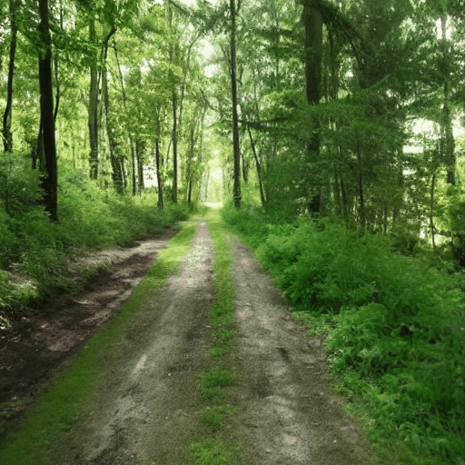
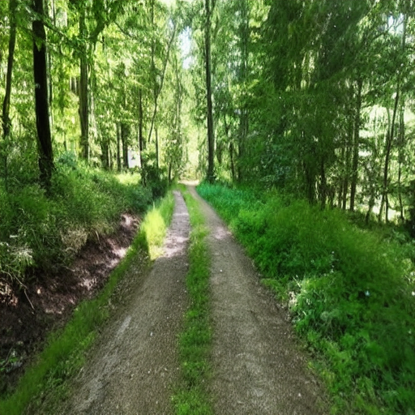
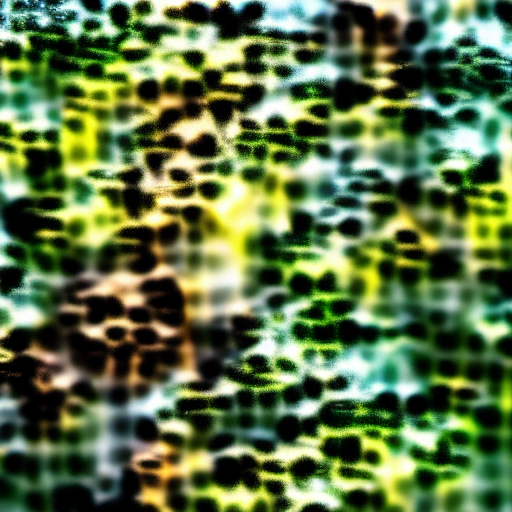
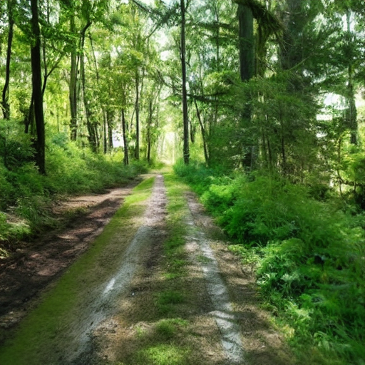

# Driving Stable Diffusion with brain variables

DMT research describes the visuals in a fairly consistent order. Geometry comes first, then forms, then figures, then a return to the room. I wanted to know whether that order falls out of an image model when the only things I touch are parameters that map to known brain variables.

So I took Stable Diffusion 1.5, started it from an ordinary photo, and wrote five knobs that each stand in for something the brain does. Then I moved them along a dose curve and measured what came out. Nothing is painted in by hand and the prompt never asks for anything psychedelic.

This is a computational model of reported visual experience. It can show a signature in the images. It can't tell you what a trip feels like, and the model isn't "tripping".

<p align="center">
  
</p>

<p align="center">
  
  
  
  <br>
  <em>Frames 0, 13 and 39 of one run. Same seed and same caption the whole way through. Only the knobs move.</em>
</p>

## The idea

Two ideas from neuroscience set this up. REBUS (Carhart-Harris and Friston) says psychedelics relax the precision of high-level priors, so the brain stops explaining away bottom-up signal and internal noise. The other is 5-HT2A gain. DMT acts on the 5-HT2A receptor and raises the gain of cortical pyramidal cells, and turning up gain in a layered visual system destabilizes it.

A latent diffusion model is loosely the same kind of system. It has a prior (the text conditioning), sensory evidence (the encoded photo), and a stack of levels (the U-Net). If the DMT arc comes from these parameter changes, it should show up here too, driven only by the knobs, from a neutral starting image.

## The five knobs

Everything comes from one number, the dose curve `D(t)`. It rises exponentially to a peak at 4 minutes, falls off more slowly after, and never quite reaches zero.

| Knob | What it does in the model | Brain variable | At the peak |
|---|---|---|---|
| `scene_precision` | weight of the encoded photo in the latent blend, with a floor above zero | precision of sensory evidence | falls to the floor |
| `prior_precision` | classifier-free guidance scale on the caption | precision of high-level priors (REBUS) | falls |
| `gain` | multiplies the output of one U-Net block, soft-clipped with tanh | 5-HT2A cortical gain | rises, `1 + gain_slope * D` |
| `depth` | which U-Net block gets the gain, shallow to deep | which cortical level destabilizes | moves deeper |
| `recurrence` | weight of the previous frame in the blend | the loop feeding on itself | rises, then falls with the dose |

Two other pieces shape the output and they aren't knobs, so I'd rather say so up front. `ds`, the denoise strength, sets how far back into noise each frame starts, and it also rides the dose curve (0.45 to 0.82 in `configs/crisp_trip.yaml`). And before a frame feeds into the next one, its color mean and contrast get matched to the photo so the loop doesn't run away.

## The rules

1. Nothing is hand-drawn. No geometry is painted in, and arm A has no spatial warp, so any pattern has to come out of the model.
2. The prompt is a neutral caption of the photo. BLIP writes it, then a filter strips 78 words like fractal, spiral, entity and psychedelic, and warns if it removed anything. If you prompt for the result you've proven nothing.
3. Sensory precision never hits zero, so the photo has a way back.
4. Measurements and their thresholds get written down before the runs they judge. Every run also saves its full config, caption included, before the first frame renders.
5. A result is a computational signature. It's never a claim about experience.

There are two arms and they're never mixed. Arm A is pure emergence. Arm B adds a log-polar warp that maps cortex to visual field (the Bressloff and Cowan picture), which is an assumption, so those runs are labeled `B_logpolar_bias` in their config.

## How a frame gets made

The VAE encodes the photo and the previous frame, and they get blended by `scene_precision` and `recurrence`. Noise is added to the depth set by `ds`. DDIM denoises it under guidance at `prior_precision`, while a forward hook multiplies the chosen U-Net block's output by `gain`. The result is decoded, contrast-matched to the photo, and becomes the "previous frame" for the next step. The photo itself is re-encoded fresh every frame.

## What happened

The main run is `configs/crisp_trip.yaml`, arm A, 40 frames, seed 0. The full write-up is in [docs/conclusion.md](docs/conclusion.md).

The run reproduced the timing of the arc and none of the content of its phases.

The image left the photo and came back. RMSE against frame 0 peaked at 0.274 at frame 13 and was back down to 0.025 by frame 39.

Periodic patterns grew out of the noise at the peak on their own. Excess periodic power at a 19 px wavelength rose to 3.0x over the natural 1/f spectrum, against 1.6x for the original photo, and the caption never had a geometry word in it.

They weren't the geometry people report, though. At frame 13, mirror and rotational symmetry stayed near zero (-0.015 to 0.049), while synthetic test patterns (concentric rings, a six-arm spiral) scored 0.98 to 0.99 on the symmetries they have. That's periodicity without symmetry, so I don't call it a Klüver form constant.

The figures never emerged.

These are the parts that failed and my best read on why.

The come-up was wrong. Surfaces were supposed to shimmer with detail intact, and instead the photo went out of focus. That came from `ds`. Raising the denoise strength scales the photo's latent down against white noise, and fine detail drowns first. The brain raises the prior and leaves the evidence alone, but this engine raises the prior by wrecking the evidence.

The geometry has a structural reason for failing. A plain multiply gets cancelled by the U-Net's normalization, so what's left of `gain` is the tanh soft-clip, and saturation makes blobs at whatever scale the block already works at. That block has one cell per 16 px, which is where the 19 px wavelength comes from. In the brain, a lateral interaction kernel picks the wavelength and the retina-to-cortex map bends it into spirals and tunnels. A scalar knob has neither.

The missing figures say nothing about DMT. Stable Diffusion's only route to a figure is the text prompt, and I strip figure words out of it on purpose. The setup decides that question and the experiment has no power over it.

The return is guaranteed by construction. The photo is re-encoded every frame with no noise and no movement, so the model is always pulled back to the same pixels. Real perception has to re-converge on a noisy, moving input.

Only four knobs moved. `depth` was pinned to the shallowest block in this config, because an earlier shallow-to-deep sweep found nothing past it.

The peak doesn't evolve on its own. The starting noise is identical every frame, so the peak is one noise pattern rendered under slowly drifting knobs.

[docs/development-plan.md](docs/development-plan.md) lays out what comes next, and each experiment has its pass or fail line set in advance. The first few are a come-up driven by `gain` alone with `ds` held flat, jittering the input photo every frame to see if the return survives, and a difference-of-Gaussians lateral kernel to see whether a selected wavelength is reachable at all. An earlier version of that kernel already failed once (the wavelength barely moved off 24.4 px), and the plan explains why the new one is a different experiment. The plan is design only in this repo.

## AI use

I used agentic AI tools for assisted coding and research, and I disclose that in the paper I'm writing from this project. The question, the design and the thresholds were all mine.

## Running it

It's set up for Apple Silicon. The configs use the `mps` device.

One problem first. `run.py` imports `src/measure/make_video.py`, and that file (along with `src/measure/metrics.py`) isn't in the repo yet, so a fresh clone fails at that import until they're pushed.

```bash
python3 -m venv .venv
.venv/bin/pip install -r requirements.txt
.venv/bin/python run.py configs/crisp_trip.yaml
```

The first run downloads Stable Diffusion 1.5 and the BLIP captioning model from Hugging Face. With no config argument, `run.py` uses the defaults in `src/core/config.py`. It refuses to render if no frame lands exactly on the dose peak.

Output goes to `output/latest/`. You get the resolved `config.yaml`, `scene.png`, the individual `frames/`, and `trip.mp4` and `trip.gif`. Whatever was in `output/latest/` before gets moved to `output/past/<timestamp>/`.

To measure the peak the same way the conclusion does:

```bash
.venv/bin/python tests/probe_apex_structure.py output/latest/frames 0 13 15
```

It only needs numpy and Pillow, and it prints the synthetic controls next to your frames so a null result is still readable.

A few things about this stack:

- Everything runs in float32 by default. `float16` and `bfloat16` are options in the config, and the VAE always stays in float32.
- The scheduler is DDIM only. Anything else is rejected.
- The safety checker is off, because a blanked frame would feed into every frame after it.
- `run.py` sets `PYTORCH_ENABLE_MPS_FALLBACK=1` so ops that aren't on Metal yet fall back to the CPU.

## Layout

```
run.py         walks the dose schedule, renders each frame, stitches the video
src/core/      config.py, dose.py, knobs.py (dose curve to knob values, plain Python)
src/render/    engine.py (one frame), hooks.py (U-Net gain hooks and the arm B warp)
configs/       run configs for both arms and several scenes
resources/     source photos
tests/         probes and sweeps (only probe_apex_structure.py runs from a fresh clone)
docs/          conclusion.md, development-plan.md, neuro-reference.md
docs/notes/    my study notes on the U-Net and the VAE latent space
assets/        the frames and GIF above
```

## Limitations

This is research on one machine, not a library. The headline numbers come from one run, on one photo, with one seed. The neuroscience citations in [docs/neuro-reference.md](docs/neuro-reference.md) came from a literature search, and each claim there is labeled by how well it was checked.

## Prior art

This builds on Carhart-Harris and Friston's REBUS model, the entropic brain hypothesis, Klüver's form constants, Ermentrout and Cowan's 1979 account of geometric hallucinations as a pattern-forming instability in visual cortex, and Bressloff and colleagues' 2001 extension of it. The gain hook is loosely in the spirit of DeepDream, which amplifies what a layer already responds to.
